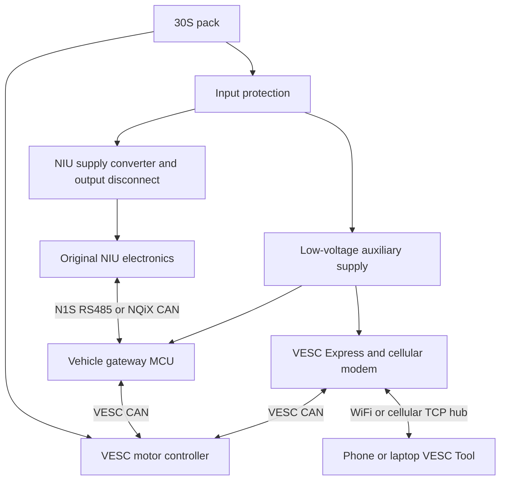

# NIU Link — 30S gateway design, revision A

Status: engineering design draft. **Not a fabrication release.** This directory
defines a new board; the legacy `bridge_n1s` design is preserved. Connector cavity
assignments, NIU supply load, NQiX protocol, component pin assignments and power
magnetics still require verification. No Gerbers or validated electrical schematic
are supplied by this revision.

## Architecture

One PCB contains an independent vehicle gateway, VESC Express connectivity, and
the auxiliary power converters. Motor battery current does not pass through it.
The VESC power stage remains connected directly to the 30S pack.



The gateway owns RS485, NIU CAN and vehicle inputs. The ESP has its own CAN
transceiver on the VESC bus; it need not route VESC Tool packets through the
gateway. Internet service failure must not suspend vehicle input processing.
The two CAN buses are physically distinct. Shared ground is not galvanic isolation.

## Decisions for revision A

| Function | Design decision | Status |
| --- | --- | --- |
| Gateway MCU | STM32G0B1RE family, with two FDCAN peripherals | Candidate; package/pin allocation pending |
| VESC Express | ESP32-C3 module, custom hardware configuration | Architecture selected; modem/storage pin budget pending |
| CAN | Three transceivers: gateway NIU, gateway VESC, ESP VESC | Required |
| CAN transceiver | TCAN1042HGV-Q1 family, 5 V supply and 3.3 V I/O | Candidate; verify exact ordering suffix/footprint |
| RS485 | Half-duplex 3.3 V transceiver with explicit DE and /RE control | Required; existing SP3485 is a reference, not a released choice |
| NIU connectors | Separate N1S and NQiX harness variants | Never assume the same connector means the same pinout |
| NIU supply | Integrated converter, fixed hardware setpoint per verified variant | Output voltage and continuous/startup load not yet known |
| Connectivity supply | Independent HV-to-12 V candidate stage; local 5 V, 3.3 V and modem rail | Must start without the NIU rail or VESC AUX output |
| Ignition off | Hardware-selectable parked connectivity; default off | Continuous parked access needs measured energy budget |
| Storage/GNSS | Optional population, secondary to control and connectivity | Do not reserve all C3 pins before the modem is selected |

See [schematic specification](schematic.md), [power design](power.md),
[firmware contract](firmware.md), [legacy audit](legacy_audit.md),
[verification plan](verification.md), and [source register](sources.md).

## Existing evidence

- User reports N1S OEM electronics working with an external step-down. Its voltage,
  current capability and load wiring were not supplied. This validates the approach
  on that setup, not a particular on-board converter design.
- The repository documents N1S RS485 at 9600 8N1 and controller node `0x20`.
  `protocol_rs485/tools/emulate.py` already contains a captured startup handshake
  and a controller responder. Its speed scaling and status semantics are not a
  complete VESC integration.
- The original NQiX CAN connector, bitrates, wake-up sequence, controller messages
  and BMS dependencies have not been established in this repository.

## Reproduce the engineering checks

From the repository root, using Python 3 and no extra dependencies:

```sh
python hardware/niu_link/tools/audit_legacy.py
python hardware/niu_link/tools/power_budget.py --output-v 72 --output-a 0.5 --efficiency 0.9
python -m unittest discover -s hardware/niu_link/tools -p 'test_*.py'
```

The power example is a **scenario**, not a measured NIU requirement. Software
checks do not establish electrical safety, EMC, ERC/DRC or hardware compatibility.
